# SecureDesk — Incident Management System

A full-stack incident management application built with **Spring Boot**, **Spring Security**, **JWT Authentication**, and **React**.

SecureDesk provides a role-based platform where employees can report incidents, administrators can assign technicians, and technicians can manage incident resolution.

## Features

### Authentication & Security
- User registration and login.
- JWT-based authentication.
- Password hashing.
- Stateless session management.
- Role-based access control (RBAC).
- Protected frontend routes.

### Incident Management
- Create and report incidents.
- View personal incidents.
- Track incident status.
- Assign incidents to technicians.
- Update incident status during resolution.

### User Roles

| Role | Permissions |
|---|---|
| EMPLOYEE | Create incidents and view personal incidents |
| TECHNICIAN | View assigned incidents and update their status |
| ADMIN | View incidents, assign technicians, and manage incident status |

### Incident Lifecycle

`OPEN` → `IN_PROGRESS` → `RESOLVED`

## Technology Stack

### Backend
- Java
- Spring Boot
- Spring Security
- Spring Data JPA
- JWT
- Maven
- H2 Database

### Frontend
- React
- Vite
- React Router
- Axios
- CSS

## Project Structure

```text
JWT-Spring-Security-React/
├── backend/
│   ├── src/
│   │   ├── main/
│   │   │   └── java/ma/enset/incident_management/
│   │   └── test/
│   └── pom.xml
│
├── frontend/
│   ├── src/
│   │   ├── components/
│   │   ├── context/
│   │   ├── pages/
│   │   ├── services/
│   │   ├── App.jsx
│   │   └── main.jsx
│   └── package.json
│
└── README.md
```

## Getting Started

### Prerequisites

- Java 17 or compatible version configured for the project.
- Maven.
- Node.js and npm.

### 1. Clone the repository

```bash
git clone https://github.com/houda-eljirari/JWT-Spring-Security-React.git
cd JWT-Spring-Security-React
```

### 2. Start the Backend

Open a terminal:

```bash
cd backend
```

Configure the JWT secret and activate the development profile.

**PowerShell:**

```powershell
$env:JWT_SECRET = "YOUR_BASE64_ENCODED_SECRET"
$env:SPRING_PROFILES_ACTIVE = "dev"
mvn spring-boot:run
```

The backend runs at:

`http://localhost:8080`

H2 Console:

`http://localhost:8080/h2-console`

### 3. Start the Frontend

Open another terminal:

```bash
cd frontend
npm install
npm run dev
```

The frontend runs at:

`http://localhost:5173`

## Development Test Accounts

The development profile initializes the following accounts:

| Username | Password | Role |
|---|---|---|
| admin_test | AdminTest123! | ADMIN |
| technicien_test | TechnicienTest123! | TECHNICIAN |

An EMPLOYEE account can be created through the registration page.

> These are development credentials only. Do not use them in production.

## API Endpoints

### Authentication

| Method | Endpoint | Description |
|---|---|---|
| POST | `/auth/register` | Register a new user |
| POST | `/auth/login` | Authenticate and receive a JWT |

### Incidents

| Method | Endpoint | Description |
|---|---|---|
| POST | `/api/incidents` | Create an incident |
| GET | `/api/incidents/my` | Get personal incidents |
| GET | `/api/incidents/{id}` | Get incident details |
| GET | `/api/incidents/assigned` | Get incidents available to the technician/admin |
| PUT | `/api/incidents/{id}/status` | Update incident status |
| PUT | `/api/incidents/{id}/assign` | Assign a technician |

All incident endpoints require JWT authentication. Access is controlled by user roles.

## Testing

### Backend Tests

Run the automated tests:

```bash
cd backend
mvn clean test
```

**Latest verified result:**
- 11 tests executed.
- 0 failures.
- 0 errors.
- Build successful.

### Frontend Production Build

```bash
cd frontend
npm run build
```

The production build completes successfully with Vite.

## Application Screenshots

The following screenshots demonstrate the main features and workflows of the Incident Management System.

### 1. Authentication

| Login Page | Registration Page |
|---|---|
| 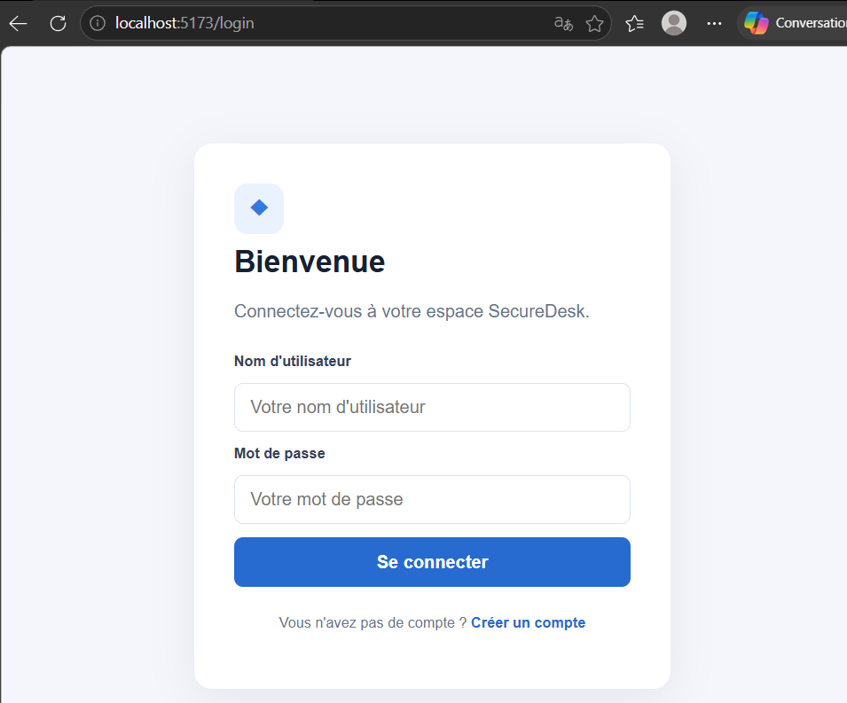 | 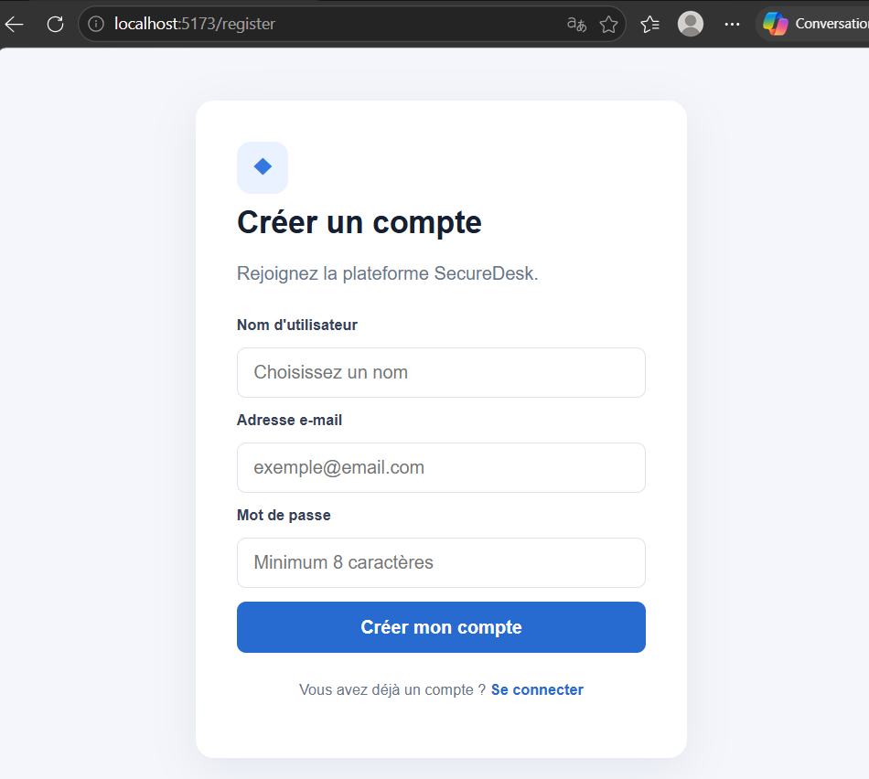 |

### 2. Employee Interface

| Employee Dashboard | Create Incident |
|---|---|
| 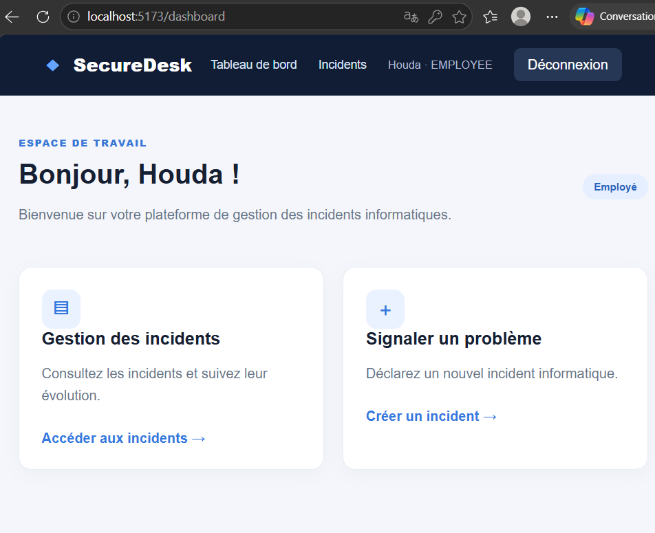 | 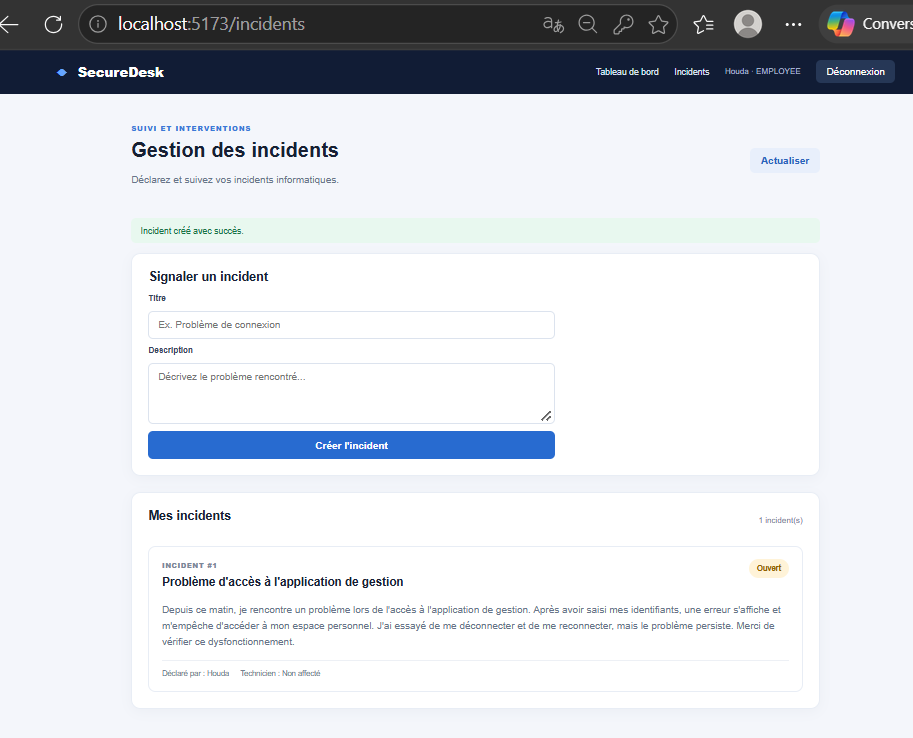 |

**Employee Incident List**

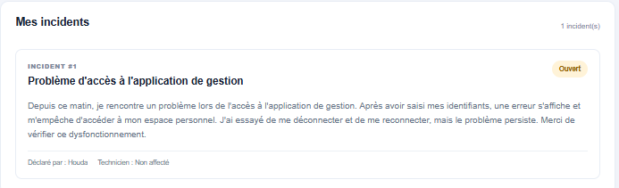

### 3. Administrator Interface

**Admin Dashboard**

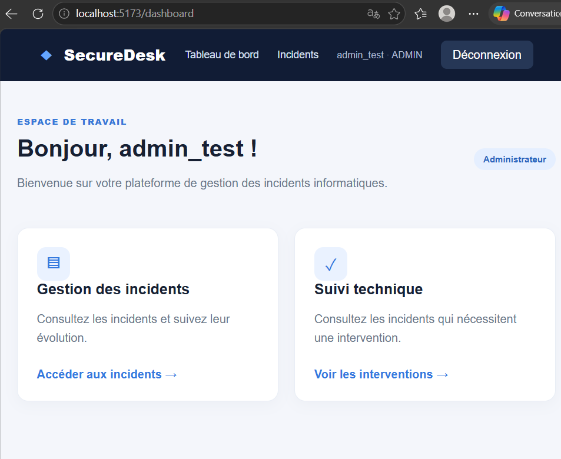

**Assign Technician**

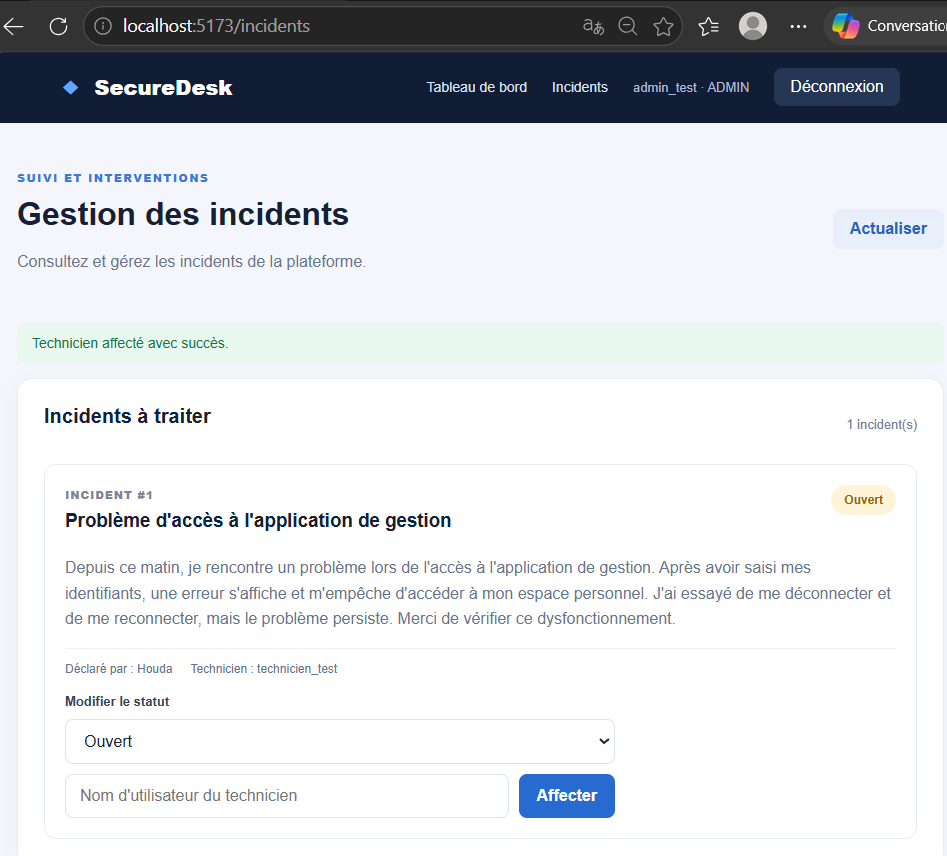

### 4. Technician Interface

**Technician Dashboard**

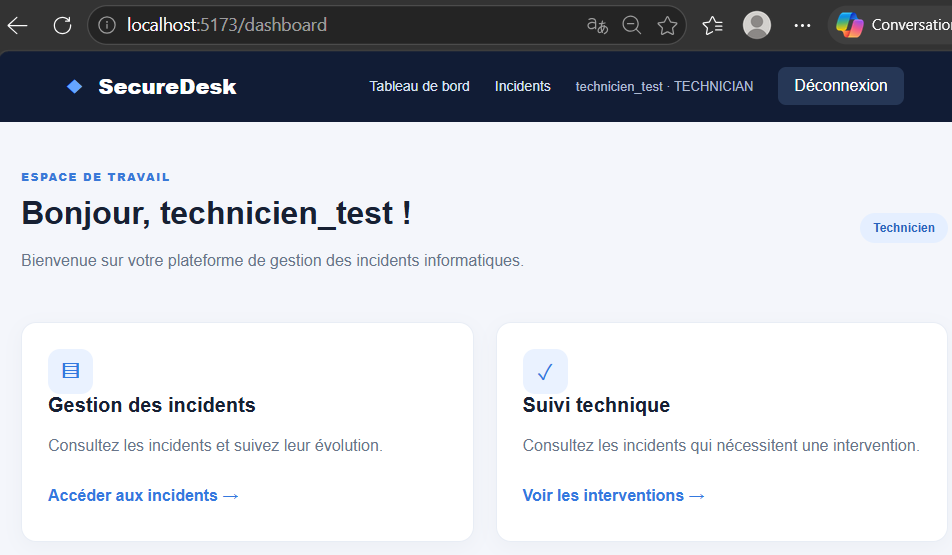

**Update Incident Status**

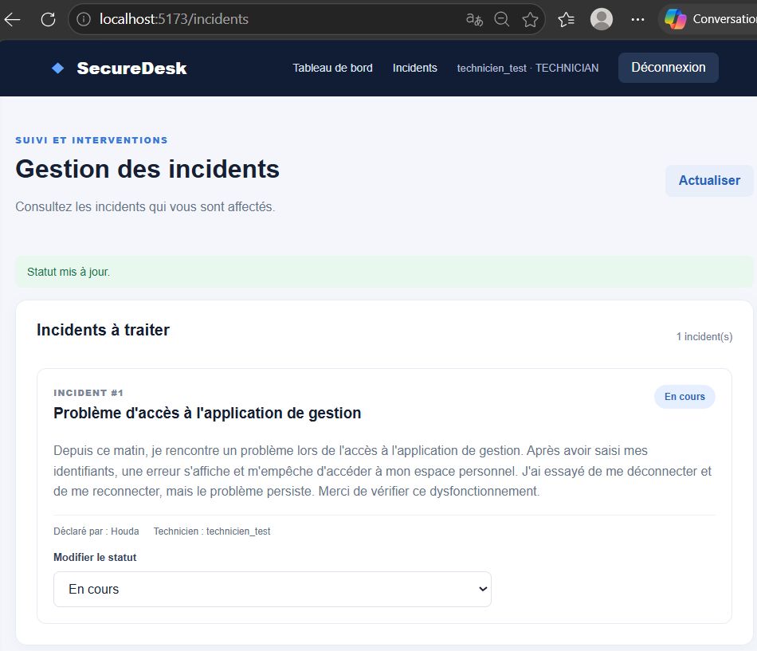

**Resolved Incident**

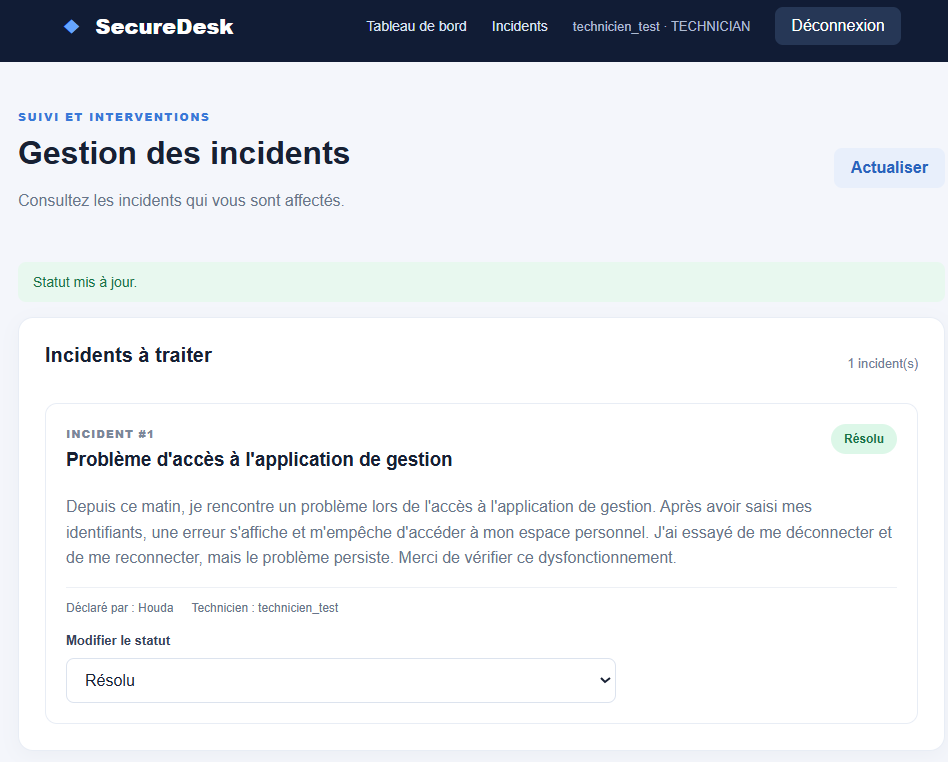

### 5. Technical Verification

**H2 Database**

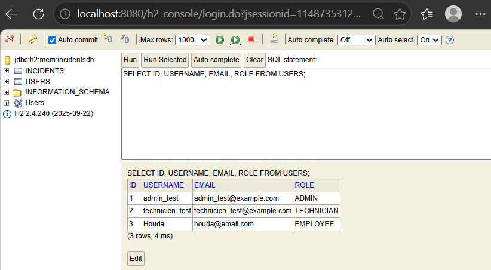

**Backend Tests**

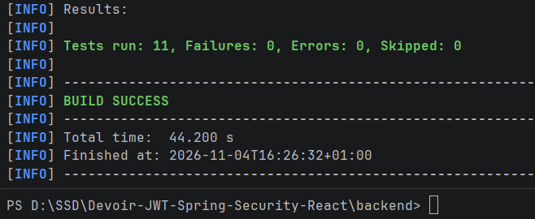

**Frontend Build**

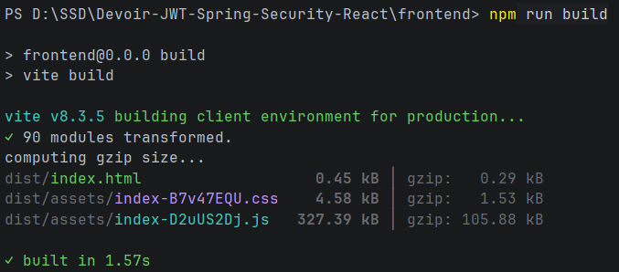
## Future Improvements

- Improve authorization error handling and security tests.
- Add pagination and advanced incident filtering.
- Add incident history and audit logs.
- Improve automated frontend testing.
- Add production database configuration.
- Deploy the application.

